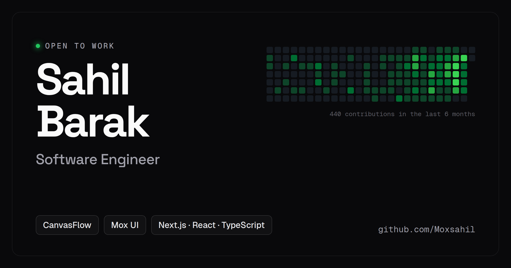

# Sahil Barak — Portfolio

My personal site: who I am, what I'm building, and the components I've made.



**Live:** [sahil-barak.vercel.app](https://sahil-barak.vercel.app)

## What's on it

- **Projects:** [CanvasFlow](https://canvasflowapp.com), a real-time collaborative whiteboard, and [Mox UI](https://moxui.dev), a free, open-source library of animated React components
- **Experience:** what I've built as the founder of both, with the numbers behind it
- **Education:** a timeline from school to my B.Tech
- **Skills:** grouped by languages, frameworks, backend, databases, cloud and tools
- **GitHub graph:** my live contribution calendar and the repos I've pushed to most recently
- **Art Gallery:** previews of my Mox UI components

## Tech stack

- [Next.js 15](https://nextjs.org) and React 19, with TypeScript
- [Tailwind CSS v4](https://tailwindcss.com)
- [Motion](https://motion.dev) for animation
- Deployed on [Vercel](https://vercel.com)

## Run it locally

```bash
git clone https://github.com/Moxsahil/sahil.me.git
cd sahil.me
npm install
npm run dev
```

Then open [http://localhost:3000](http://localhost:3000).

## Contact

- GitHub: [@Moxsahil](https://github.com/Moxsahil)
- LinkedIn: [sahil-barak](https://www.linkedin.com/in/sahil-barak/)
- Email: sahilmk01@gmail.com

## Credits

This site is built on [Swami Malode's portfolio](https://github.com/swamimalode07/swamii.me), used under the MIT License. See [LICENSE](LICENSE).
